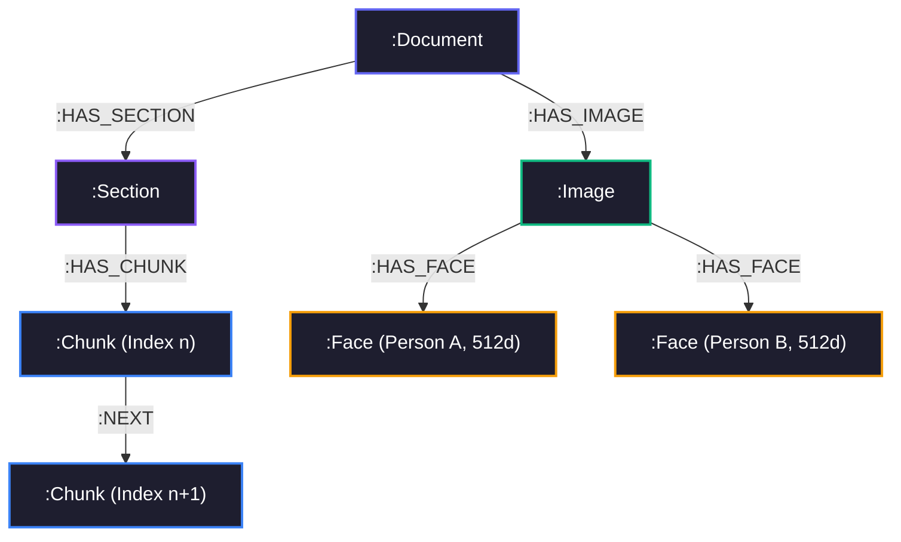

# Universal Multimodal Knowledge Graph RAG

An enterprise-grade, domain-agnostic **Hybrid Graph-RAG** platform built with **LlamaIndex, Neo4j, FastAPI, and InsightFace**. It combines dense vector retrieval, BM25 full-text keyword search, graph-based context expansion, table-to-narrative synthesis, local multimodal vision analysis, and reverse image search with ArcFace facial identity recognition.

---

## Key Features

### 1. Hybrid Retrieval + Reciprocal Rank Fusion (RRF)
- **Dense Vector Search**: 384-dimensional dense vectors powered by `BAAI/bge-small-en-v1.5` stored in Neo4j Vector Indexes.
- **Lucene BM25 Full-Text Search**: Full-text indexing across document content, section titles, and headers.
- **Reciprocal Rank Fusion (RRF)**: Merges dense vector and keyword search scores dynamically using standard RRF ($k=60$) to provide high recall and accuracy across diverse domains.

### 2. Graph Hierarchy & 2-Hop Context Expansion
- **Hierarchical Graph Schema**: Captures deep document layout structure:
  - `(:Document)-[:HAS_SECTION]->(:Section)-[:HAS_CHUNK]->(:Chunk)`
  - Sequential sentence flow: `(:Chunk)-[:NEXT]->(:Chunk)`
- **Adjacent Context Expansion**: When a relevant chunk is retrieved, the graph traverser fetches adjacent preceding and succeeding chunks (`[:NEXT*1..2]`), restoring surrounding narrative context that naive vector chunking loses.

### 3. Table-to-Narrative Synthesis
- **Tabular Data Understanding**: Parses Markdown tables row-by-row and synthesizes natural language descriptions of quantitative facts and columns.
- **Cross-Encoder Table Booster**: Uses `smart-table` / `BAAI/bge-reranker-base` cross-encoders to ensure quantitative table rows and metrics receive top relevance scores.

### 4. Background Document Ingestion Queue (Concurrency = 1)
- **Worker Queue**: Ingests files sequentially to prevent CPU/GPU memory exhaustion during heavy embedding and OCR workloads.
- **4-Stage Pipeline**: Real-time progress updates through:
  1. **Converting**: High-fidelity PDF-to-Markdown conversion via Marker and Gemini/Vision OCR.
  2. **Chunking**: Semantic markdown-aware chunking with table synthesis and header breadcrumb tracking (`#` through `####`).
  3. **Embedding**: 384-dimensional dense embedding generation.
  4. **Indexing**: Graph node generation and relationship linking in Neo4j.
- **Document Management**: Real-time queue monitoring, category filtering, and 1-click document deletion (cleans document, sections, chunks, and images from the graph).

### 5. Multimodal Vision Understanding
- **Local VLM Analysis (Ollama `gemma4:e2b`)**: Automatically extracts structured 3-point visual summaries from uploaded images:
  - **Visual Content**: Scene description, dominant colors, layout, and entities.
  - **Extracted Text**: In-image text, signs, logos, or conversational chat text.
  - **Contextual Domain**: High-level categorization (e.g., General, Technical, Document, Screenshots).
- **Ranked Image Results**: Image search queries trigger visual cards with 3-point summaries, click-to-zoom modal, and direct downloads.

### 6. Reverse Image Search & ArcFace Facial Recognition
- **Face Detection & Alignment**: RetinaFace / SCRFD (via InsightFace `buffalo_l`) scans query images and aligns cropped faces using 5 facial landmarks (eyes, nose, mouth).
- **ArcFace Embeddings**: Computes 512-dimensional normalized identity vectors for each detected face.
- **Neo4j Face Index**: `face_vector_index` (512-dim cosine similarity) indexes all faces linked to parent images: `(:Image)-[:HAS_FACE]->(:Face)`.
- **Intelligent 3-Branch Execution Flow**:
  - **Case 1 (Single Face Detected)**: Searches the graph using ArcFace cosine similarity with a strict threshold ($\ge 0.48$) to match the exact individual without false positives.
  - **Case 2 (Multiple Faces Detected)**: Prompts user with a Google Photos-style face picker modal and interactive chat chips, letting them select a specific individual or search across all detected faces (union).
  - **Case 3 (Zero Faces Detected)**: Automatically falls back to local Ollama VLM semantic understanding to retrieve visually and conceptually similar images.

### 7. Modern Dark Glassmorphic Web UI
- **Visual Design**: 60 FPS interactive Liquid Canvas background animation with floating organic blobs.
- **Workspace Tabs**: Switch seamlessly between conversational Chat and Knowledge Graph Document Management.
- **Reverse Image Search Camera Button**: Upload any image directly from the chat bar for instant identity or visual lookup.
- **Streaming WebSocket Chat**: Real-time token streaming with live activity status logs, Markdown tables, and KaTeX math formatting.
- **Source Inspection Drawer**: Collapsible citations drawer detailing matched documents, header breadcrumb paths, categories, and match scores.

---

## Neo4j Knowledge Graph Schema



### Neo4j Indexes
- `chunk_vector_index`: 384-dimensional cosine vector index on `(:Chunk).embedding`.
- `chunk_fulltext_index`: Lucene full-text search on `(:Chunk).text`, `header_path`, and `document_name`.
- `image_vector_index`: 384-dimensional cosine vector index on `(:Image).embedding`.
- `image_fulltext_index`: Lucene full-text search on `(:Image).summary`, `point1`, `point2`, and `point3`.
- `face_vector_index`: 512-dimensional cosine vector index on `(:Face).embedding`.

---

## Project Structure

```
Generic llama index rag/
├── input_docs/               # Raw PDF documents organized into categorical subfolders
├── markdown_output/          # Converted Markdown documents and extracted assets
├── uploaded_images/          # Uploaded images, cropped faces (_faces), and search temp queries
├── backend/
│   ├── main.py               # FastAPI application, WebSocket chat, REST endpoints
│   ├── document_worker.py    # Background ingestion worker (Marker, VLM, ArcFace, Neo4j)
│   ├── face_engine.py        # InsightFace buffalo_l detector and ArcFace embedder
│   └── requirements.txt      # Backend Python dependencies
├── ui/
│   ├── index.html            # Dark glassmorphic HTML interface & modal dialogs
│   ├── style.css             # Liquid animation, face chips, responsive styling
│   └── app.js                # WebSocket streaming, tab manager, reverse image search logic
├── 1_convert_documents.py    # Standalone CLI: PDF-to-Markdown conversion via Marker / OCR
├── 2_build_graph.py          # Standalone CLI: Markdown chunking, embedding & Neo4j graph indexing
├── 3_query_graph.py          # Standalone CLI & Core retrievers (Hybrid, Image, Face)
├── config.py                 # LLM, embedding model, and Neo4j connection configuration
├── utils.py                  # Table-to-narrative synthesis & semantic markdown chunker
├── requirements.txt          # Root Python dependencies
└── .env                      # Environment configuration variables
```

---

## Setup & Installation

### Prerequisites
- **Python**: Version 3.10, 3.11, or 3.12.
- **Docker**: Used **exclusively** for running the Neo4j database container.
- **Ollama**: Running locally with a model such as `gemma4:e2b` or `llama3.2-vision`.
- **NVIDIA GPU** (Optional): CUDA acceleration for embeddings and ArcFace face detection.

---

### Step 1: Start Neo4j in Docker

The application requires Neo4j 5.x with the APOC plugin. Run the official Neo4j Docker container:

#### Linux / macOS:
```bash
docker run -d \
  --name neo4j-rag \
  -p 7474:7474 -p 7687:7687 \
  -e NEO4J_AUTH=neo4j/password \
  -e NEO4J_PLUGINS='["apoc"]' \
  -v neo4j_data:/data \
  neo4j:5.26.0-community
```

#### Windows (PowerShell):
```powershell
docker run -d `
  --name neo4j-rag `
  -p 7474:7474 -p 7687:7687 `
  -e NEO4J_AUTH=neo4j/password `
  -e NEO4J_PLUGINS='["apoc"]' `
  -v neo4j_data:/data `
  neo4j:5.26.0-community
```

- **Neo4j Browser**: `http://localhost:7474`
- **Bolt Connection**: `bolt://localhost:7687` (Username: `neo4j`, Password: `password`)

---

### Step 2: Configure Environment Variables

Create or update your `.env` file in the project root:

```ini
# ==========================================
# LLM Provider Configuration (Local Ollama)
# ==========================================
LLM_PROVIDER=openai
LLM_MODEL_NAME=gemma4:e2b
LLM_API_BASE=http://localhost:11434/v1
LLM_API_KEY=ollama
LLM_CONTEXT_WINDOW=32768

# ==========================================
# Embedding Model Configuration
# ==========================================
EMBEDDING_MODEL_NAME=BAAI/bge-small-en-v1.5

# ==========================================
# Neo4j Database Connection
# ==========================================
NEO4J_URI=bolt://localhost:7687
NEO4J_USERNAME=neo4j
NEO4J_PASSWORD=password

# ==========================================
# Reranker Configuration
# ==========================================
RERANKER_TYPE=smart-table
RERANKER_TOP_N=8

# ==========================================
# Compute & Hardware Acceleration
# ==========================================
TORCH_DEVICE=cuda
CUDA_VISIBLE_DEVICES=0
USE_GPU=1
```

---

### Step 3: Install Python Dependencies

Create and activate a Python virtual environment, then install the dependencies:

```bash
# Create virtual environment
python -m venv markervenv

# Activate virtual environment
# Windows:
.\markervenv\Scripts\activate
# Linux/macOS:
source markervenv/bin/activate

# Install dependencies
pip install -r requirements.txt
```

> [!NOTE]
> On first startup, InsightFace will automatically download the `buffalo_l` model bundle (~300MB) to `~/.insightface/models/` for facial landmarking and ArcFace identity extraction.

---

### Step 4: Ensure Ollama is Running

Make sure Ollama is active with your configured vision/text model:

```bash
ollama run gemma4:e2b
```

---

### Step 5: Start the Application

Run the FastAPI backend server:

```bash
python -m uvicorn backend.main:app --host 0.0.0.0 --port 8000 --reload
```

Open your browser and navigate to:
**`http://localhost:8000/ui/`**

---

## Application Usage Guide

### 1. Document Management & Ingestion
1. Navigate to the **Documents** tab in the top navigation or sidebar.
2. Drag and drop any document (`.pdf`, `.md`, `.txt`) or image (`.jpg`, `.jpeg`, `.png`, `.webp`).
3. Select an existing category or enter a custom one (e.g. *Finance*, *HR*, *Technical*).
4. Click **Upload & Process**. The background worker will process the document through conversion, chunking, embedding, and indexing without freezing the UI.
5. Review all indexed documents in the **Indexed Knowledge Graph Documents** table, with real-time chunk counts and deletion controls.

### 2. Conversational Graph RAG Chat
- Ask complex questions in natural language. Follow-up questions are automatically rewritten into standalone queries based on chat context.
- View real-time token streaming and status updates (e.g. `Searching knowledge graph...`, `Synthesizing answer...`).
- Expand the **Sources** drawer to inspect retrieved passages, match scores, and exact header paths.

### 3. Visual & Reverse Image Search
- **Image Search by Query**: Ask questions like `"Find photo of conference stage"` or `"Show diagram of system architecture"`. The agent classifies the visual intent, searches `image_vector_index`, and displays ranked cards with zoom and download buttons.
- **Reverse Image Search (Camera Button)**:
  1. Click the **Camera icon** in the chat bar.
  2. Select any image file.
  3. The app scans for faces with ArcFace:
     - **1 Face**: Automatically runs a 512-dim cosine similarity search against known faces in the graph.
     - **Multiple Faces**: Opens an interactive face picker modal (Google Photos style) displaying cropped faces and confidence scores. Choose a specific face or click **Search All Faces**.
     - **No Faces**: Automatically analyzes the image with the local VLM (`gemma4:e2b`) and retrieves visually similar images based on semantic features.

---

## Standalone CLI Scripts

You can also run pipeline components individually from the terminal:

### 1. Convert PDFs to Markdown
```bash
python 1_convert_documents.py
```
*Converts PDFs located in `input_docs/` into clean Markdown files inside `markdown_output/`.*

### 2. Build the Knowledge Graph
```bash
python 2_build_graph.py
```
*Parses Markdown files in `markdown_output/`, chunks text with table synthesis, generates 384d BGE embeddings, and populates Neo4j.*

### 3. Interactive CLI Query Engine
```bash
python 3_query_graph.py
```
*Runs an interactive terminal session supporting text search, image intent search, and reverse image face queries.*

---

## API Endpoints

| Method | Endpoint | Description |
|---|---|---|
| `GET` | `/api/status` | System health check (API status, Neo4j connection, chunk count, model) |
| `WS` | `/api/chat` | WebSocket for streaming conversational search, RRF retrieval, and image results |
| `POST` | `/api/documents/upload` | Upload documents or images to the background ingestion queue |
| `GET` | `/api/documents/queue` | Real-time queue status and progress tracking |
| `GET` | `/api/documents` | List all indexed documents and image nodes in Neo4j |
| `DELETE`| `/api/documents/{name}` | Delete a document, its chunks, sections, and images from Neo4j |
| `GET` | `/api/images` | List all indexed images with metadata and visual summaries |
| `POST` | `/api/search/reverse-image` | Reverse image search with ArcFace facial recognition and VLM fallback |
| `GET` | `/images/{filename}` | Serve original uploaded images and face crops |
| `GET` | `/ui/` | Serves the dark glassmorphic web interface |

---

## License

This project is licensed under the Apache License 2.0.
