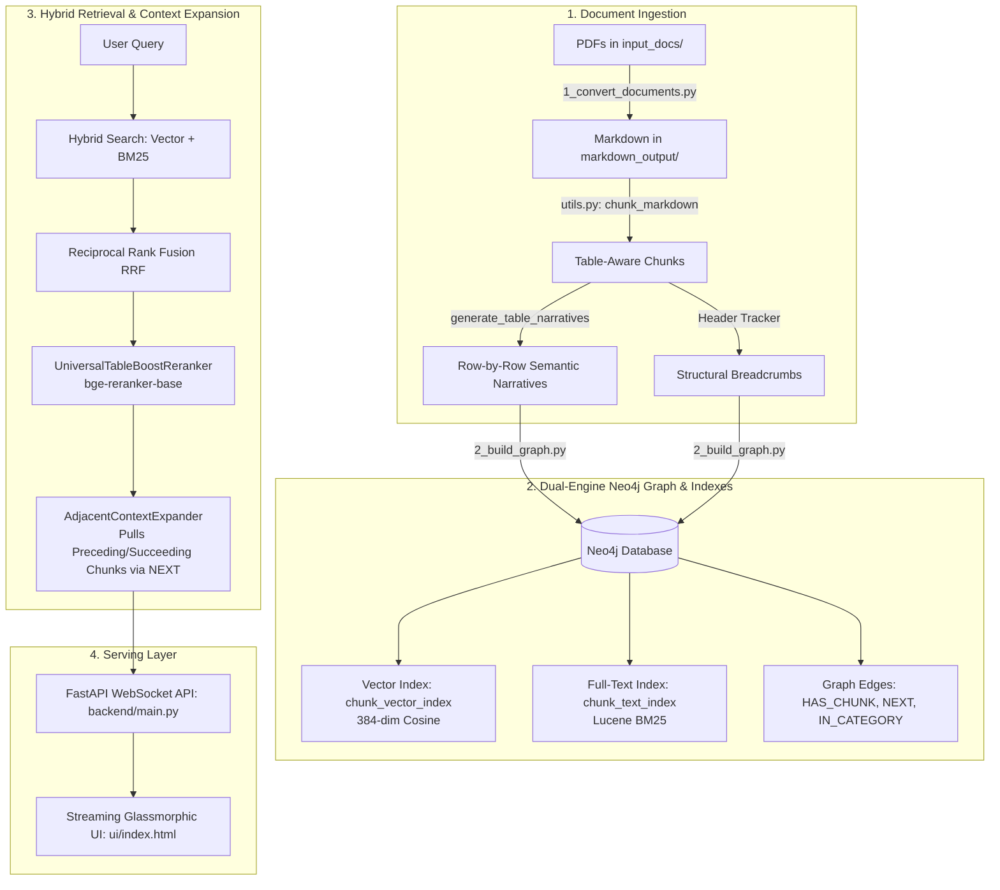

# Walkthrough: Universal Graph-RAG Platform

The new, domain-agnostic **Universal Graph-RAG platform** has been created in `d:\Joulewise\Generic llama index rag`. The original project in `d:\Joulewise\Llama index rag` remains completely untouched.

---

## What Was Created

```
d:\Joulewise\Generic llama index rag\
├── input_docs/                   # Input PDFs directory (supports nested category folders)
├── markdown_output/              # Converted markdown files
├── 1_convert_documents.py        # PDF layout conversion via Marker
├── 2_build_graph.py              # Table-aware chunking, embeddings, and Neo4j graph & indexes
├── 3_query_graph.py              # Interactive CLI query engine
├── config.py                     # Global LLM, embedding, and Neo4j configuration
├── utils.py                      # Universal table narrative generator & semantic chunker
├── download_models_hf.py         # Hugging Face model weight downloader
├── docker-compose.yml            # Multi-container orchestration (Neo4j, Backend, UI)
├── requirements.txt              # Python requirements
├── .env & .env.example           # Environment configurations
├── README.md                     # Documentation & usage guide
├── backend/
│   ├── main.py                   # Streaming FastAPI backend with WebSocket endpoint
│   ├── Dockerfile
│   └── requirements.txt
└── ui/
    ├── index.html                # Universal chat UI with status monitoring
    ├── style.css                 # Glassmorphic dark theme
    ├── app.js                    # Live streaming markdown & source citations
    ├── Dockerfile
    ├── nginx.conf
    └── .dockerignore
```

---

## Architectural DNA & Key Features



### 1. Universal Table Narratives
When parsing markdown tables (financial balance sheets, technical specifications, legal schedules, comparison matrices), `utils.py` converts each row into natural language sentences (e.g. `- For "Total Revenue ($M)": Q1 2025 is 120.5, Q2 2025 is 145.2, Growth YoY is +20.5%.`). This bridges the gap between tabular data and dense vector embeddings.

### 2. Neo4j Knowledge Graph & Adjacent Context Expansion
- Nodes: `:Document`, `:Category`, `:Chunk`.
- Relationships: `(:Document)-[:HAS_CHUNK]->(:Chunk)`, `(:Chunk)-[:NEXT]->(:Chunk)`, `(:Document)-[:IN_CATEGORY]->(:Category)`.
- During query synthesis, `AdjacentContextExpander` traverses `[:NEXT]` edges in Neo4j to dynamically pull surrounding paragraphs into the prompt, eliminating the lost-in-the-middle problem.

### 3. Hybrid Search + Reciprocal Rank Fusion (RRF)
Combines dense semantic vectors (`BAAI/bge-small-en-v1.5`) with exact Lucene BM25 full-text keywords.

### 4. Cross-Encoder Reranking
Uses `BAAI/bge-reranker-base` to rerank the top candidate chunks, with general quantitative boosting for tabular and statistical queries.

---

## How to Run

### Option 1: Using Docker (Includes Neo4j, Backend, UI)
From `d:\Joulewise\Generic llama index rag`:
```bash
docker compose up --build -d
```
- **Web UI**: `http://localhost:3006`
- **Backend API**: `http://localhost:5005`
- **Neo4j Browser**: `http://localhost:7474` (Username: `neo4j`, Password: `password`)

### Option 2: Local Python Execution

1. **Start Neo4j Docker container**:
   ```bash
   docker run -d --name neo4j-generic -p 7474:7474 -p 7687:7687 -e NEO4J_AUTH=neo4j/password neo4j:5.26.0-community
   ```

2. **Index Documents**:
   Place PDF files in `input_docs/` and run:
   ```bash
   python 1_convert_documents.py
   python 2_build_graph.py
   ```

3. **Start the API & UI**:
   ```bash
   python -m uvicorn backend.main:app --host 0.0.0.0 --port 5005 --reload
   ```
   Open `http://localhost:5005/ui/index.html` in your browser.
